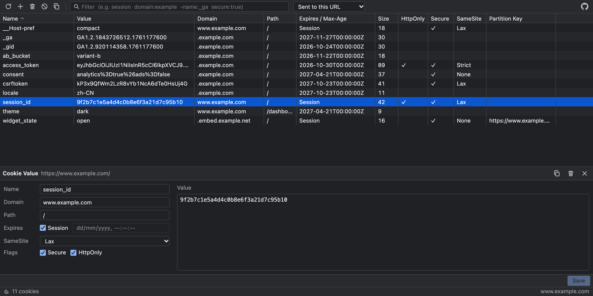
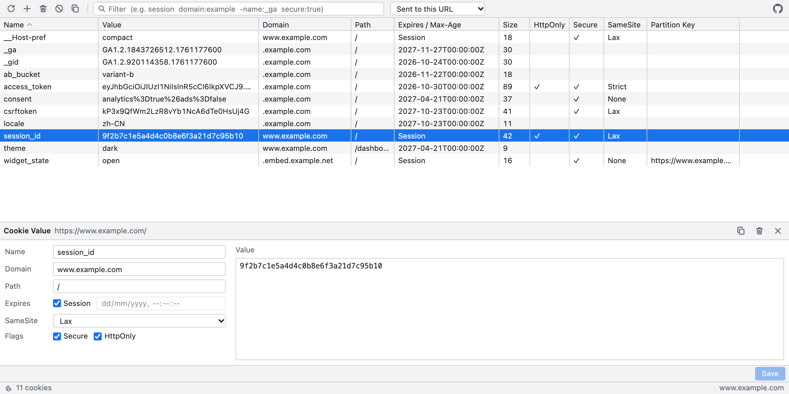

# Cookie Editor

A Chrome DevTools panel for inspecting and editing the cookies of the page you are debugging. It looks and behaves like the built-in DevTools tables, follows the DevTools light/dark theme, and is built with Preact, TypeScript and Vite on Manifest V3.



<details>
<summary>Light theme</summary>



</details>

## Features

- **Cookies tab in DevTools** that lists cookies of the inspected tab, including partitioned (CHIPS) cookies and the right cookie store for incognito or container tabs.
- **Table view**: Name, Value, Domain, Path, Expires / Max-Age, Size, HttpOnly, Secure, SameSite and Partition Key. Click a header to sort, drag a header edge to resize, use the arrow keys to move and `Delete` to remove the selected cookie.
- **Filtering** with free text and field terms (see below).
- **Scope switch**: cookies sent to the current URL, or including subdomains of the host.
- **Editing**: add a cookie, or edit any attribute of an existing one in the bottom pane (`Cmd/Ctrl+S` saves). Renaming a cookie or changing its domain/path replaces the old one.
- **Bulk actions**: delete all shown (respects the filter, asks first) and copy shown cookies as JSON.
- **Live updates** when cookies change or the page navigates.

### Filter syntax

Terms are separated by spaces and all must match.

| Term | Meaning |
| --- | --- |
| `session` | Text found in name, value, domain or path |
| `name:_ga` | Field contains text (`name`, `value`, `domain`, `path`, `samesite`) |
| `secure:true` | Exact match (`secure`, `httponly`, `session`, `size`) |
| `-name:_ga` | A leading `-` negates the term |
| `"two words"` | Quotes keep a phrase together |

## Install

```bash
npm install
npm run build
```

Then open `chrome://extensions`, enable **Developer mode**, choose **Load unpacked** and select the `dist` folder. Open DevTools on any http(s) page and switch to the **Cookies** tab.

Requires Chrome 119 or newer.

## Development

| Command | Description |
| --- | --- |
| `npm run build` | Production build into `dist/` |
| `npm run watch` | Rebuild on change (reload the extension in `chrome://extensions`) |
| `npm run typecheck` | Type-check with `tsc` |
| `npm run icons` | Regenerate the PNG extension icons in `public/icons` |
| `npm run screenshot` | Render the built panel with mock data into `docs/` (needs Google Chrome, or set `CHROME_PATH`) |

Layout:

```
public/manifest.json     MV3 manifest (copied to dist)
devtools.html, src/devtools.ts   registers the "Cookies" panel
panel.html, src/panel/
  App.tsx                toolbar, layout, actions
  CookieTable.tsx        sortable, resizable table
  CookieDetail.tsx       edit form
  cookies.ts             wrappers around chrome.cookies
  filter.ts              filter parser
  hooks.ts               loading and live refresh
scripts/                 icon and screenshot generators
```

## Permissions

- `cookies` and `<all_urls>` host access: required by `chrome.cookies` to read and write cookies of any site you inspect. Nothing is sent anywhere; all data stays in the browser.

## Limitations

- Only http(s) pages are supported.
- The cookie list is not virtualized, so very large jars may feel slow.
- `Priority` is not shown because `chrome.cookies` does not expose it.

## Repository

<https://github.com/worktools/cookies-devtool>
